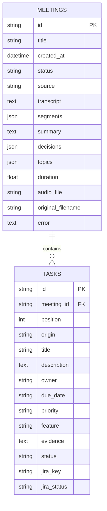

# College project notes

**Title:** AI-Powered Meeting Analysis & Task Automation System

**Application name:** MeetFlow

## Problem and objective

Meeting commitments are easily missed when notes, decisions, and tasks are maintained separately. This system stores the recording and transcript alongside structured meeting outcomes, makes action items reviewable, and creates traceable Jira issues.

The implemented flow is capture -> transcription -> speaker alignment -> AI analysis -> human review -> task delivery. Source quotations provide context for each extracted commitment. Missing credentials or provider failures preserve the transcript and allow retry.

## Modules

1. **Capture:** uploaded audio/video, browser microphone recording, or transcript import.
2. **Transcription:** faster-Whisper on CPU with an int8 Whisper base model; hosted Groq Whisper is an alternative.
3. **Speaker detection:** optional pyannote community-1, matching speaker turns to transcript segments by temporal overlap.
4. **Analysis:** a Groq-hosted model returns schema-validated summaries, decisions, topics, and tasks. The verified model is Qwen 3.8 27B, replacing the unavailable Llama 3.3 model.
5. **Review:** source playback, speaker correction, task owners and priorities, task board and progress.
6. **Automation:** Jira REST API v3 creates issues from reviewed tasks with meeting context and trace labels.
7. **Archive:** PostgreSQL history, text search, Markdown/CSV exports, and printable PDF reports.

## Database design

Meeting states: `queued`, `transcribing`, `analyzing`, `ready`, `transcribed`, `failed`. `transcribed` means the transcript is available and AI analysis is waiting for its credential.

Task progress: `open`, `in_progress`, `done`. Jira delivery: `not_sent`, `sending`, `sent`, `uncertain`. Separate delivery and progress fields preserve the distinction between creating an issue and completing the work.

## Demonstration

1. Start the website with `start.bat` and show the overview.
2. Open the labeled sample meeting. Explain the summary, decisions, and source quotes.
3. Open Transcript, correct a speaker name, and review a task's owner.
4. Add or edit an action item; change its progress and reload to show persistence.
5. Open the task board and decision log, then search the meeting archive.
6. Upload `tests/fixtures/meeting.wav` to show real local speech transcription and timestamp playback.
7. With Groq configured, run AI analysis on that transcript and review the extracted commitments.
8. With Hugging Face model access configured, process a multi-speaker recording and correct its labels.
9. With Jira configured, create a reviewed issue and open its Jira link.
10. Download Markdown notes and CSV tasks; open the PDF report and save it using Ctrl+P.

The spoken test recording mentions delaying a release until Friday, Alex fixing a login bug, Sam testing authentication, and API rate limiting. It was synthesized for repeatable verification. It does not demonstrate multi-speaker diarization.

## Validation and limits

Backend verification covers input validation, storage, missing-key recovery, manual-task preservation, speaker alignment, safe exports, issue payloads, and duplicate Jira delivery. Browser verification covers the complete local capture/review workflow and mobile layout.

Live Groq output is verified with the configured key. Gated speaker inference and actual Jira issue creation still require their credentials. Integration contract tests use mocked service responses. The sample is explicitly labeled as curated content.

The local API requires a browser session, rejects remote and cross-site requests, disables API documentation routes, and applies request and AI job limits. Credentials remain in the backend and are redacted from output and logs.

The project runs locally for one user, records the microphone, processes recordings after submission, and does not join online meeting platforms. A public multi-user deployment would need authentication, access controls, a durable job queue, and deployment-specific configuration.
